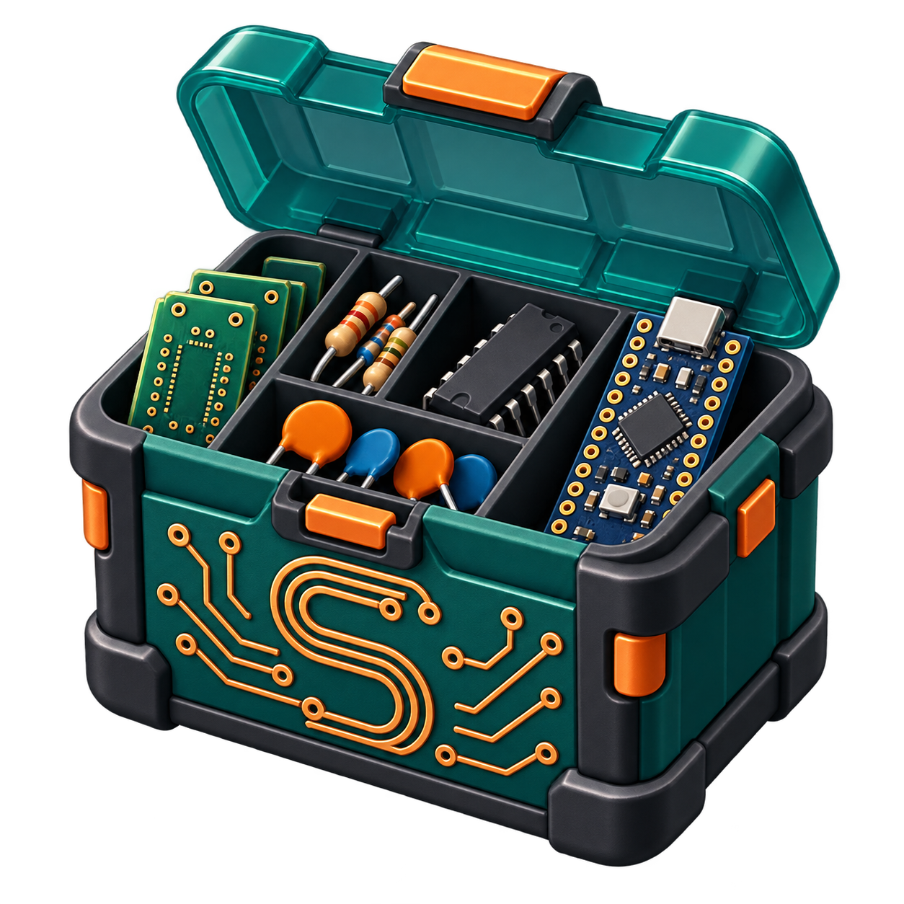

<div align="center">
  

  # Simone's LibrePCB Component Box

  A carefully crafted collection of reusable components for LibrePCB.
</div>

## About

This library contains symbols, components, packages, devices, and selected 3D
models created for personal electronics projects and shared with the LibrePCB
community.

The current release was created and tested with **LibrePCB 2.1.1**.

## Included parts

### Modules and integrated circuits

- Daisy Seed3, including a custom 40-pin THT package and detailed STEP model
- 6N138 optocoupler
- 74HC14 hex Schmitt-trigger inverter
- CD4051 analog multiplexer/demultiplexer
- MCP6022 dual operational amplifier
- OPA2134PA dual audio JFET-input operational amplifier
- OPA197 single precision rail-to-rail operational amplifier in SOIC-8
- LT1054 switched-capacitor voltage converter in PDIP-8
- MCP23017 I/O-expander module
- I2C LCD display module
- KY-040 rotary encoder module

### Connectors and controls

- Female 5-pin DIN MIDI connector
- TS jack, with original and compact wired footprints
- Two-pin DC power jack connection, with original and compact wired footprints
- Neutrik NMJ4HCD2 mono switched PCB jack, including its official STEP model,
  with both switched and standard TS device variants
- External switch
- Three-position SPDT switch (`ON-OFF-ON`) with a 2.54 mm wired footprint
- External 3PDT footswitch with nine accessible schematic contacts
- Four-wire interface to an external 3PDT bypass and LED board
- Wired three-pin potentiometer connection (`POT-WIRE-P2.54`)
- 16 mm right-angle PCB potentiometer with 5 mm terminal pitch
- Horizontal blue/white trimmer with a measured 6 x 6 mm THT footprint and
  a custom coloured STEP model (`Trimmer (THT 6x6 mm)`)

### Discrete semiconductors

- 1N5817 Schottky diode with a reusable DO-41 THT package
- Nexperia PMEG2010ER 20 V / 1 A Schottky rectifier with SOD-123W / CFP3
  package, manufacturer-recommended reflow land pattern, and official STEP model
- Common-cathode RGB LED with a four-pin 2.54 mm wired footprint
- Common-cathode red/green 5 mm THT LED with a custom STEP model

### Capacitors

- Panasonic SMD aluminium electrolytic capacitor, case C (5 x 5.8 mm)
- Panasonic SMD aluminium electrolytic capacitor, case D (6.3 x 5.8 mm)
- Panasonic SMD aluminium electrolytic capacitor, case F (8 x 10.2 mm)

The Panasonic capacitor packages use the manufacturer's recommended land
patterns and official STEP models. Ready-to-use devices are included for
`EEEFK1V100R`, `EEEFK1V470P`, `EEEFK1V101P`, and `EEEFK1V221P`.

The potentiometer devices and the OPA197 SOIC-8 device reuse standard elements
from the LibrePCB Base Library, which is declared as a dependency.

## Installation

### Horizontal trimmer

Select `Trimmer (THT 6x6 mm)` as a device of the standard `Potentiometer`
component. It uses `TRIMMER-THT-6X6-MEASURED`: the paired terminals are
6 mm apart, and the isolated terminal is 6 mm from their line. The footprint
uses 1.2 mm finished holes and 2.4 mm copper pads. The sample's fit and the
isolated terminal's identity as the wiper (pad 2) were confirmed by the user.

The device maps pad 2 to the wiper, pad 1 to CCW, and pad 3 to CW. The outer
terminal rotation direction is assigned by convention and remains unverified
on the actual sample. The custom STEP model reproduces the blue body, white
cross-slot rotor, and three terminals aligned with the footprint; body details
are approximate. This is a measured sample-specific footprint, not a universal
footprint for every 6 mm trimmer or an official manufacturer CAD model.

### External 3PDT bypass wiring

Use `3PDT Footswitch (External)` to document the external switch in the
schematic. It contains three mechanically linked changeover contacts, labelled
`A1/A2/A3`, `B1/B2/B3`, and `C1/C2/C3`. The common terminals are `A2`, `B2`,
and `C2`. This component is schematic-only and does not place a switch footprint
on the main PCB. Check the physical terminal orientation on the actual switch.

Use the separate `3PDT Bypass Module (Wired)` device for the four wire connections
on the main PCB. Its `3PDT-BYPASS-WIRE-P2.54` package has 2.54 mm pad spacing,
1.0 mm finished holes, 2.0 mm copper pads, and no surrounding silkscreen border.

| Main PCB connection | Musikding 3PDT + LED board connection |
| --- | --- |
| `9V` | `+9V` |
| `GND` | `GND` |
| `PCB_IN` | `BI` (effect circuit input) |
| `PCB_OUT` | `BO` (effect circuit output) |

The jacks connect directly to `JI` and `JO` and the corresponding ground pads
on the external board. The LED and its series resistor also belong to the
external assembly. When documenting these parts on the main project schematic,
use schematic-only components for parts that are not mounted on the main PCB.
The four-wire package represents solder connections, not the physical footprint
of the switch or the Musikding daughterboard. The switch symbol and the
four-wire interface are separate components; wire their nets explicitly.

### Install the library

Close LibrePCB, then clone the repository into the `data/libraries/local`
directory of your LibrePCB workspace:

```bash
git clone https://github.com/SimoneDeAngelis95/Simones-LibrePCB-Component-Box.git \
  Simones-LibrePCB-Component-Box.lplib
```

Alternatively, download the repository as a ZIP archive, extract it into the
same directory, and ensure that the extracted folder ends with `.lplib`.

Restart LibrePCB and wait for the library scan to complete.

## Library structure

- `sym/` - schematic symbols
- `cmp/` - logical components and signals
- `pkg/` - PCB packages and STEP models
- `dev/` - mappings between components and packages

## Contributing

Bug reports, dimensional corrections, and new part suggestions are welcome
through GitHub Issues. Please include the manufacturer's datasheet whenever a
change concerns mechanical dimensions or pin assignments.

## License

This library is released under the
[Creative Commons CC0 1.0 Universal](LICENSE.txt) public domain dedication.
You may use, modify, and redistribute it for any purpose, including commercial
projects, without attribution requirements.
